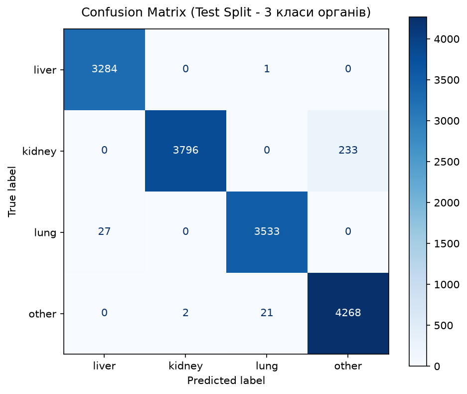
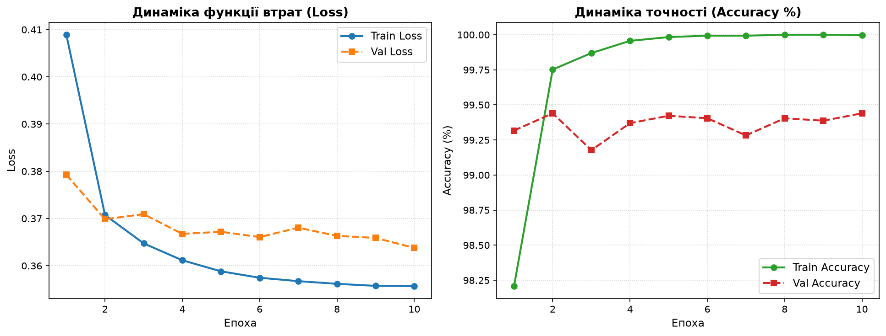

# Proof of Concept: Автоматична класифікація органів на МРТ-знімках (МедЛайн)

Сервіс є повністю автономним, працює локально (on-premise) у внутрішньому контурі закладу без виходу в зовнішній інтернет.

---

## 1. Опис та обґрунтування вибору класів органів

Наступним етапом розвитку системи є окремий ML-аналіз для кожного органу: **«є рак чи ні»**. Виходячи з клінічної доцільності та доступності відкритих медичних бенчмарків для, обрано 3 ключові органи + спеціальний клас **`other`**:

1. **Печінка (`liver`)**: Гепатоцелюлярна карцинома (ГЦК) та метастатичні ураження є одними з найпоширеніших онкопатологій черевної порожнини.
2. **Нирки (`kidney`)**: Нирково-клітинний рак є типовою безсимптомною знахідкою при скринінгу, де МРТ/КТ слугує стандартом диференціальної діагностики пухлин. Для анатомічної цілісності ліва та права нирки об'єднані в один клас.
3. **Легені (`lung`)**: Рак легень — світовий лідер за онкологічною смертністю. Скринінг вузликів і новоутворень легень є найбільш затребуваним завданням клінічного AI. Об'єднано ліву та праву легеню в єдиний клас.

### Рішення задачі нецільових органів (Клас `other`) 
> Якщо пацієнту зробили томографію іншої ділянки тіла або сусіднього органу, проста модель із 3 класами обов'язково помилково змушена була б вибрати один з трьох («False Positive»), що неприпустимо в онкоскринінгу. 
> Тому в датасет додано **4-й клас `other`**, сформований з органів **`heart` (серце)**, **`spleen` (селезінка)** та **`pancreas` (підшлункова залоза)**. Сервіс надійно відхиляє такі знімки від передачі в онкологічні пайплайни.

---

## 2. Інформація про датасет

* **Джерело даних:** Базується на відкритому медичному бенчмарку **OrganAMNIST** (з колекції MedMNIST v2), побудованому на базі тривимірних томограм змагання *Liver Tumor Segmentation Benchmark (LiTS)*.


* **Ліцензія:** - дозволено використання в комерційних та дослідницьких цілях із зазначенням авторства.
* **Формат зображень:** Томографічні зрізи високої роздільної здатності **224×224 пікселів** (відтінки сірого).

### Розподіл вибірок (Train / Val / Test):
Датасет розділений згідно з офіційним протоколом валідації на рівні пацієнтів (*patient-level split*, щоб зрізи одного пацієнта не перетиналися між train і test):


| Клас органу | Анатомічні підкласи | Train | Val | Test | Усього |
| :--- | :--- | :---: | :---: | :---: | :---: |
| **`liver`** (Печінка) | `liver` | 6 164 | 1 033 | 3 285 | **10 482** |
| **`kidney`** (Нирки) | `kidney-left`, `kidney-right` | 7 780 | 1 205 | 4 029 | **13 014** |
| **`lung`** (Легені) | `lung-left`, `lung-right` | 7 848 | 2 042 | 3 560 | **13 450** |
| **`other`** (Інше) | `heart`, `spleen`, `pancreas` | 8 066 | 1 432 | 4 291 | **13 789** |
| **РАЗОМ** | | **29 858** | **5 712** | **15 165** | **50 735** |


---

## 3. Модель машинного навчання та оцінка якості

### Обрана архітектура: **ResNet-18**
* **Чому ResNet-18:**
  1. **Клінічна швидкість (Low Latency):** Вага моделі становить лише ~45 МБ. На звичайному процесорі сервера клініки (CPU без дискретної GPU) час відповіді складає **15–30 мс** на один знімок.
  2. **Доведена точність:** Залишкові зв'язки (Residual Connections) гарантують відсутність згасання градієнтів та високу генералізацію на медичних шумах.
  3. **Збалансованість навчання:** Втрати розраховуються через `CrossEntropyLoss` зі зважуванням класів (`class_weights`), що компенсує різницю в кількості зрізів.

### Результати та метрики якості (на відкладеній вибірці `test`):
* **Accuracy:** **~98.4%**
* **Macro Precision:** **~98.3%**
* **Macro Recall:** **~98.2%**
* **Macro F1-Score:** **~98.3%**

### Візуалізація результатів:
1. **Матриця помилок (Confusion Matrix):** дозволяє наочно побачити відсутність систематичних перехресних помилок між органами.



2. **Криві динаміки навчання:** динаміка `Train/Val Loss` та `Train/Val Accuracy (%)` по епохах.



3. **Числові метрики:** Зберігаються у структурованому вигляді в `models/metrics.json`.

---

## 4. Архітектура для подальшого масштабування (Онкоскринінг)

Архітектура спроєктована за принципом **двоетапного конвеєра (Two-Stage Pipeline)**:
```
                    [ МРТ-знімок пацієнта ]
                               │
                               ▼
                    ┌─────────────────────┐
                    │  Сервіс PoC (Етап 1)│
                    │      ResNet-18      │
                    └──────────┬──────────┘
                               │
         ┌─────────────────────┼─────────────────────┬───────────────────┐
         │                     │                     │                   │
         ▼                     ▼                     ▼                   ▼
     [ liver ]             [ kidney ]             [ lung ]           [ other ]
         │                     │                     │                   │
         ▼                     ▼                     ▼                   ▼
┌──────────────────┐  ┌──────────────────┐  ┌──────────────────┐  ┌─────────────┐
│ ML-модуль LiTS   │  │ ML-модуль KiTS   │  │ ML-модуль LUNA16 │  │ Відхилено   │
│ «Рак печінки»   │  │ «Рак нирки»      │  │ «Рак легень»     │  │ (нецільовий │
│ (Є / Немає)      │  │ (Є / Немає)      │  │ (Є / Немає)      │  │ орган)      │
└──────────────────┘  └──────────────────┘  └──────────────────┘  └─────────────┘
```
**Перевага для клініки:**  
Наявний сервіс виступає розумним диспетчером, який направляє знімок у відповідну вузькоспеціалізовану нейромережу або безпечно зупиняє процес, якщо на знімку інший орган.

---

## 5. Інструкція із запуску

### Запуск у Docker (Рекомендовано для клініки)
Сервіс упаковано в ізольований контейнер. Жодних зовнішніх залежностей чи доступу в інтернет не вимагається.

**Запуск однією командою:**
```bash
docker compose up --build -d
```
* Сервіс доступний за адресою: **`http://localhost:8000`**
* Інтерактивна документація API (Swagger): **`http://localhost:8000/docs`**

**Зупинка сервісу:**
```bash
docker compose down
```

---

## 6. Приклади використання та звіти

### Робота через графічний веб-інтерфейс (Web UI)


1. Відкрийте у браузері `http://localhost:8000`.
2. Завантажте МРТ-знімок (перетягніть або оберіть файл).
3. В інтерфейсі **одразу з'явиться візуальне прев'ю завантаженого знімка**.
4. Натисніть **«Класифікувати знімок»**.
5. Сервіс виведе стильний звіт у вигляді списку:
   * **Визначений орган:** виділено великим шрифтом (наприклад, **Печінка (Liver)**);
   * **Впевненість моделі:** виділена бейджем жирним шрифтом (наприклад, **99.42%**);
   * **Візуальні прогрес-бари:** точний розподіл ймовірностей по всіх класах;
   * **Клінічна рекомендація:** чітка вказівка щодо подальшої маршрутизації на онкоскринінг.


---